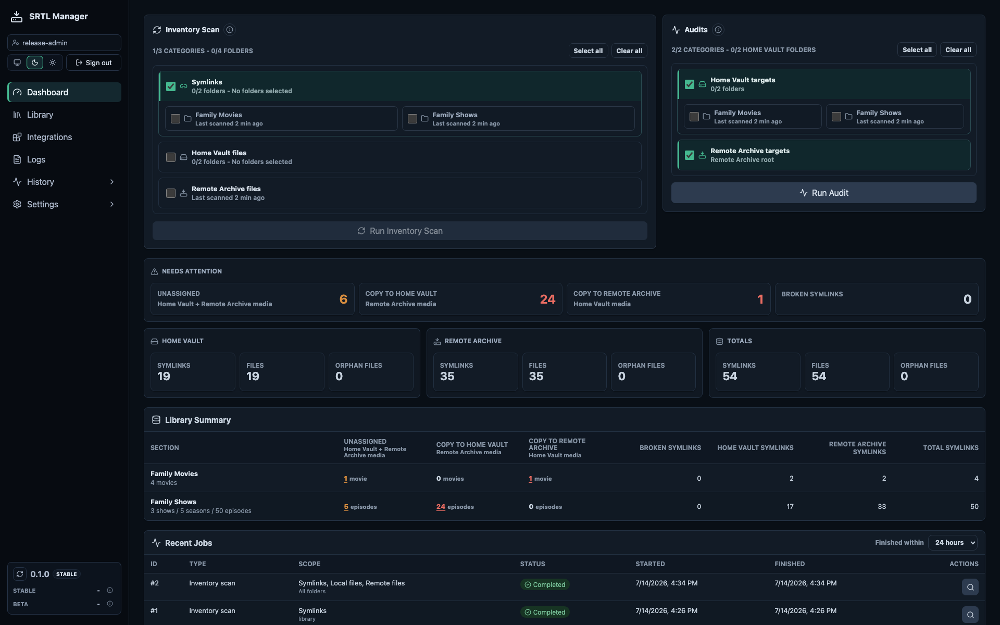
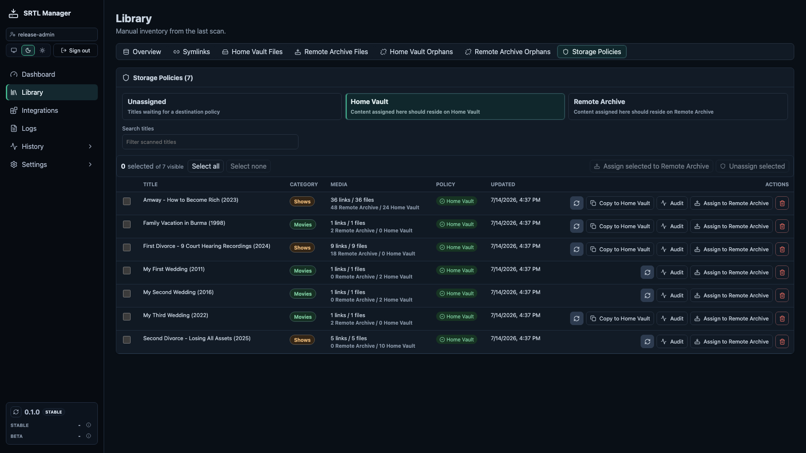
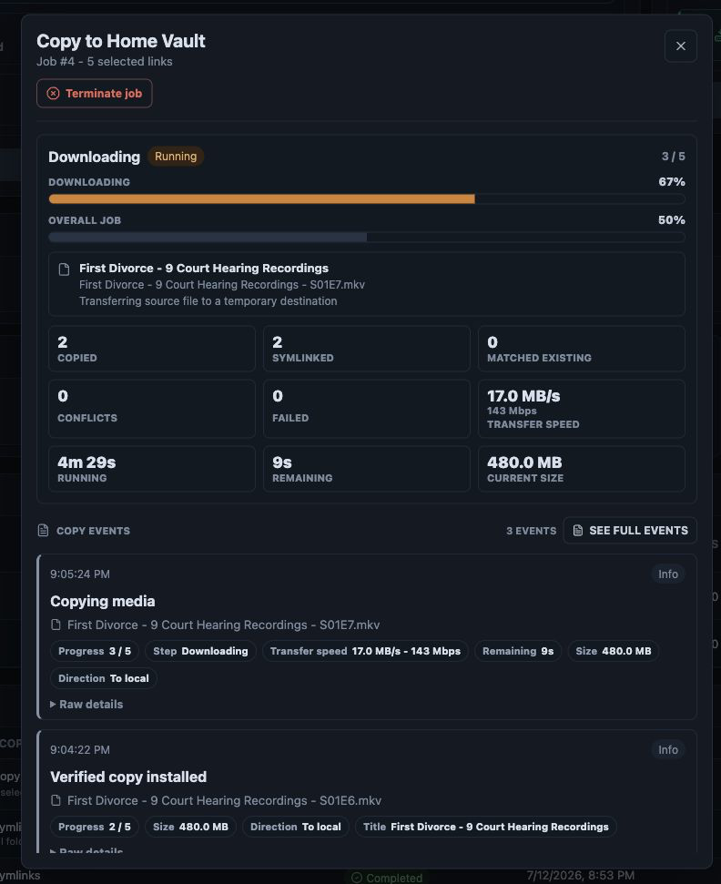

# SRTL Manager

Do you keep family videos in remote locations? Want the important ones, such as footage from your third wedding, stored locally so you can fall asleep to it every night without worrying that your WRT54G router might drop the signal and reboot for the ninth time today? Tired of manually repointing symlinks whenever those files move? SRTL Manager inventories local and remote storage, copies selected files in either direction, verifies transfers before switching links, and helps prevent a bad copy from freezing at the exact moment someone says, "I do." If your files have multiple homes but managing their symlinks should not be a full-time job, this app is for you.

SRTL Manager is a local-first web app for inventorying and maintaining a symlink-backed file library, with storage policies, audits, guarded copies, and durable job history in one focused interface.

## Highlights

- Guided first-run account, path, section, policy, and initial-scan setup, protected by a one-time setup token. Session list, sign-out of other devices, and a security activity log in Settings. See [accounts and sessions](docs/accounts-and-sessions.md).
- Symlink, local-root, remote-root, and orphan inventory with targeted title rescans, exact target checks, a daily scheduled scan, and unmounted-storage protection, plus [categorized orphan review and purge](docs/orphan-review.md) (including hollow files and folders with no video) with a restorable holding period. Damaged files can be deleted the same way, and any delete can optionally [ask Radarr or Sonarr to search for a new copy](docs/radarr.md#re-requesting-after-a-delete).
- Per-location storage policies using editable friendly names, plus an Unassigned queue for newly discovered titles. Each folder can optionally give new titles a [default policy](docs/default-policy.md).
- Fast and deep audits across local and remote targets.
- Nightly verified database backups with retention, and a warning on every page if one fails or is overdue. See [database backups](docs/backups.md).
- Bidirectional copies with live progress, transient transfer retry, conflict handling, configurable verification, source/title risk checks, and source media checks that reject hollow, zero-filled, truncated, or unreadable files before transferring.
- Safe job termination, complete event timelines, restart recovery, and durable per-file copy journals.
- Configurable parallel job and copy-file execution with database-backed overlap protection.
- Required path-change review before different configured roots or storage mount sources can affect managed links.
- Editable storage-location names while deployment paths remain environment-managed.
- Optional Radarr integration: policy tags that follow SRTL storage policies, optional unmonitoring after copies to local storage, webhook-triggered title rescans, and automatic or manual folder mapping. No policy tags are preselected; copies stay manual. See the [integration guide](docs/radarr.md).
- Optional Sonarr integration, the TV counterpart: policy tags on series, per-episode unmonitoring after copies to local storage (the series stays monitored), webhook-triggered series rescans, and any number of instances. See the [Sonarr guide](docs/sonarr.md).
- Optional watch sync between Plex and Jellyfin: watched state and resume positions per user pair, one way or both ways, matched by exact SRTL path. See the [watch sync guide](docs/watch-sync.md).
- Postgres-backed API and worker services in a hardened container stack.
- Dark, light, and system themes with responsive administration views.

SRTL Manager is early software. Keep backups and review copy and audit results before relying on unattended workflows.

## Screenshots

These screenshots come from a disposable fictional library built solely for documentation. They contain no private paths or real library data.

**Dashboard**



**Storage policies**



**Live copy progress**



## Quick Setup

Docker Engine, Docker Compose v2, and `curl` are required.

```bash
curl -fsSL -o docker-compose.yml https://raw.githubusercontent.com/ramphex/SRTL-Manager/main/docker-compose.yml
curl -fsSL -o .env.example https://raw.githubusercontent.com/ramphex/SRTL-Manager/main/.env.example
```

Copy `.env.example` to `.env`, then edit these deployment values before starting:

- `SYMLINK_DIR`: the existing absolute path containing the managed symlinks.
- `SRTL_LOCATION_1_PATH` and `SRTL_LOCATION_2_PATH`: existing absolute storage paths. Their friendly names are set during onboarding and can be changed later in Settings > Library.
- `SRTL_POSTGRES_PASSWORD`: a database password you must set before Compose will start.
- `SRTL_EXTRA_SYMLINK_DIRS` (optional): folders of symlinks kept by other tools, checked before an orphan purge. Each also needs a read-only mount. See [Symlinks kept by other tools](docs/orphan-review.md#symlinks-kept-by-other-tools).
- `SRTL_BACKUP_HOST_PATH`: the folder for scheduled database backups, outside your media roots and owned by `SRTL_UID`. Create it first, or Docker creates it as root and Settings > Backups will say it cannot be written. See [Database backups](docs/backups.md).
- `SRTL_SECRET_KEY`: the key that encrypts saved Plex tokens and Jellyfin, Radarr and Sonarr API keys. Generate it once with `openssl rand -base64 32` and keep a copy with your backups. Compose will not start without it. See [Backup And Restore](#backup-and-restore).
- `SRTL_UID` and `SRTL_GID`: the host account that can read the managed roots and write to destinations used by copy jobs.
- `SRTL_BIND_HOST`, `SRTL_WEB_PORT`, and the security settings: review these if the defaults do not match your network or reverse proxy. See [Reverse proxy and network security](#reverse-proxy-and-network-security).

The owner's username and password are created in the browser during first-run setup and do not belong in `.env`. Setup asks for a one-time setup token from the server log, so nobody else who can reach a new instance can claim it first.

Run `cp .env.example .env`, protect it with `chmod 600 .env`, validate it with `docker compose config --quiet`, then pull and start the stack:

```bash
docker compose pull
docker compose up -d
```

Open `http://<server-ip>:5179` unless a different port was selected. The browser then completes account creation, section setup, initial policy strategy, and the first scan.

Creating the owner account needs the one-time setup token that the API prints when it starts without an account. Find it with:

```bash
docker compose logs api | grep "Setup token"
```

It is also saved in the API container as `/tmp/srtl-data/setup-token` (`docker compose exec api cat /tmp/srtl-data/setup-token`). Without Compose, use `docker logs <api container name>`. The token works once; until setup is done, a new one is printed each time the API container starts. See [Accounts, sessions and security activity](docs/accounts-and-sessions.md).

The default configuration follows the current stable `latest` image. Pin `SRTL_IMAGE` to a numbered image tag when repeatable deployments are more important than automatically following stable updates.

> **Beta builds:** When a beta image is available, set `SRTL_IMAGE=ghcr.io/ramphex/srtl-manager:beta` in `.env`. Beta builds contain newer work that has not yet been promoted to a stable release.

## Deployment Model

`.env` is the single source of truth for deployment-owned paths, credentials, host binding, and ports. Persistent database files stay in `./data` beside `docker-compose.yml`; that path does not need configuration. Numbered storage-location variables keep deployment identity separate from friendly names managed in Settings > Library. Friendly names, section names, display order, policies, and user preferences live in Postgres.

The API receives read-only root mounts. The worker alone receives writable roots for copy and path-migration jobs. Postgres is reachable only inside the Compose network.

### Worker concurrency

The single Compose worker service can host any positive number of independent job slots. Set `SRTL_WORKER_COUNT` to the desired slot count; there is no fixed two-worker ceiling. Jobs still pass database-backed admission, resource-claim, and lease checks, so adding slots does not allow two jobs to mutate the same managed resources.

Settings > Advanced can keep selected symlink folders in one sequential scan job, the default, or queue one job per folder so independent folders use the available scan slots concurrently.

Settings > Advanced also controls automatic scanning. By default, every symlink scan also queues the remote storage scan as a separate job, and the worker queues a full inventory scan once a day after 05:00 server time, starting the day after it is first deployed. A scan stops without changing the inventory when a storage root it depends on is unreadable or empty, as an unmounted NFS share or FUSE mount usually is, so a missing mount cannot mark links broken or files missing.

The optional `SRTL_MAX_RUNNING_JOBS` setting limits total simultaneous jobs and must not exceed `SRTL_WORKER_COUNT`. `SRTL_MAX_RUNNING_SCANS`, `SRTL_MAX_RUNNING_AUDITS`, and `SRTL_MAX_RUNNING_COPIES` apply per-type limits, may be zero to pause that job type, and must not exceed the total-job limit. When omitted, the total limit follows the configured worker count and the per-type limits follow that total limit.

`SRTL_COPY_FILE_CONCURRENCY` controls how many files one copy job may transfer at once. `SRTL_MAX_ACTIVE_COPY_FILES` is the independent worker process-wide copy-file ceiling and must be at least the per-job value. Their defaults keep one file active per copy job while allowing separate copy jobs to use separate slots. Setting both values above the worker count is supported, including parallel file transfers from one copy job in a one-slot worker; start conservatively and raise copy limits only when the storage endpoints and network can sustain the additional I/O.

Scale with `SRTL_WORKER_COUNT`; do not simultaneously run `docker compose up --scale worker=...`. The supported deployment model keeps job slots and the active-copy-file safeguard inside one worker process. Compose gives that process two minutes to stop active jobs and perform safe rollback during shutdown.

`SRTL_JOB_HISTORY_RETENTION_DAYS` controls automatic cleanup of terminal job, event, audit, and scan history. The default is 90 days; set it to `0` to preserve all history. Jobs with unresolved copy-recovery state are always retained.

The API checks the public GitHub Releases endpoint for stable and beta version information at startup and when version status is refreshed. This request does not include credentials, paths, or inventory data.

When a configured root changes, restart the stack. The UI enters maintenance mode until it validates and applies a path migration or the prior value is restored. This rebases managed paths; it does not move stored content. Routine Linux remounts are accepted automatically when the canonical path, mount point, filesystem type, and mount source are unchanged; exact device and inode checks still fence active filesystem mutations.

### Reverse proxy and network security

Every API route needs a signed-in account whose role allows it, except sign-in, first-run setup, `/api/health/live`, and the static app files. Radarr and Sonarr webhooks need their per-instance secret. `/api/health` and `/api/health/ready` report worker detail only to direct local requests, such as a container health check, or to a signed-in admin.

Direct LAN access over HTTP needs no extra settings. Behind a reverse proxy that terminates HTTPS, such as Nginx Proxy Manager:

- `SRTL_PUBLIC_ORIGIN`: the address people use, for example `https://srtl.example.com`. Changes from that origin are accepted, and an `https` origin makes session cookies `Secure`. If you also open SRTL by its LAN address, add that origin to `SRTL_ALLOWED_ORIGINS`, for example `http://192.168.1.20:5179`. Browsers refuse `Secure` cookies over plain HTTP, so sign-ins at a listed `http` address use a plain session cookie, and that address stays as exposed as any plain HTTP connection.
- `SRTL_TRUST_PROXY`: the proxy's address or CIDR range, for example `192.168.1.10`, `172.18.0.0/16` for a shared Docker network, or `loopback` when the proxy runs on the same host. Only these peers may set `X-Forwarded-For` and `X-Forwarded-Proto`, which SRTL uses for client addresses in rate limits and logs and for the request protocol. `true` is refused at startup because it would trust headers any client can send; replace it with the proxy's address when upgrading.
- Published port: keep it reachable only by the proxy. Set `SRTL_BIND_HOST=127.0.0.1` when the proxy runs on the same host, or remove the `ports` block and use the commented proxy network in `docker-compose.yml` when the proxy is another container.
- `SRTL_API_DOCS`: leave it off. When on, `/documentation` is served to owners and admins only.
- `SRTL_SESSION_IDLE_HOURS` and `SRTL_SESSION_MAX_AGE_DAYS`: a browser is signed out after 12 hours without activity and 14 days after sign-in by default. Settings > User settings lists every session and can sign out one or all others, and shows a log of sign-ins, failures, lockouts and account changes.
- `SRTL_OUTBOUND_ALLOW_CIDRS`: the addresses SRTL may call for Plex, Jellyfin, Radarr and Sonarr. The default, `private,public`, allows LAN and internet addresses but not loopback; add `loopback` for a server on the same host outside Docker, or list CIDR ranges such as `192.168.1.0/24` to allow only those. Link-local and cloud metadata addresses are always refused, every request connects to the address it checked, and plex.tv sign-in is not affected.

Sign-in locks a username for a growing time, up to 15 minutes, after 5 failed attempts from any address, and an address after 20 failed attempts. New passwords need at least 12 characters. With secure cookies the session cookie uses the `__Host-` prefix. Only browsers on the host or the local network are told that a new instance still needs setup; everyone else opens setup at `/setup`, which is printed in the API log with the setup token and looks the same whether or not setup is still open. See [Accounts, sessions and security activity](docs/accounts-and-sessions.md).

A saved token or API key is only sent to the address it was entered for. Changing a Jellyfin, Radarr or Sonarr address needs its API key again, and changing a Plex address signs that server out until you use **Sign in with Plex** again or paste a token.

Requests without a session are limited to 600 a minute per client address (`SRTL_ANONYMOUS_REQUESTS_PER_MINUTE`), and request bodies to 256 KB except on the signed-in routes that need more. Set the proxy's own body limit to at least 70 MB if you restore watch sync backups through it.

The [reverse proxy guide](docs/reverse-proxy.md) has step-by-step Nginx Proxy Manager settings (HTTPS, upload size, the Now Playing stream, blocking health detail, keeping Radarr and Sonarr webhooks on the LAN), an Authentik forward-auth setup, short Caddy and Traefik examples, and a checklist to finish before exposing SRTL to the internet.

Error responses from the API never include stack traces, file paths, database text, or what Plex, Jellyfin, Radarr or Sonarr sent back. A failure that SRTL did not expect ends with `Reference: <id>`; the same ID is in the `X-Request-Id` response header and on the matching `docker compose logs api` lines, which hold the full detail. SRTL also keeps a short record of who started copies and purges, discarded partial copies, removed media servers and Radarr or Sonarr instances, and stopped streams, with the time and the item IDs. A signed-in admin can read it at `/api/system/action-audit`.

## Backup And Restore

SRTL Manager backs up its database every night, verifies each backup, and shows a failed or overdue one on every page. Configure it in **Settings > Backups**, or use **Back up now** before an upgrade or a path change. The [database backups guide](docs/backups.md) covers the location, what gets removed, and how to restore.

Backups need `SRTL_BACKUP_HOST_PATH`: a folder owned by `SRTL_UID` and outside your media roots. They are not useful for restoring saved credentials without `SRTL_SECRET_KEY`, so keep a copy of that key separately. See [Secret key](#secret-key).

To take a one-off plain SQL dump by hand instead:

```bash
(umask 077 && docker compose exec -T postgres sh -c 'pg_dump -U "$POSTGRES_USER" "$POSTGRES_DB"' > srtl-manager-backup.sql)
```

Restore that plain dump into an empty database while app services are stopped:

```bash
docker compose stop api worker
docker compose exec -T postgres sh -c 'dropdb -U "$POSTGRES_USER" --if-exists "$POSTGRES_DB" && createdb -U "$POSTGRES_USER" "$POSTGRES_DB"'
docker compose exec -T postgres sh -c 'psql -U "$POSTGRES_USER" "$POSTGRES_DB"' < srtl-manager-backup.sql
docker compose start api worker
```

Keep `.env`, `.env.backup.*`, and database dump files private. Dumps contain account hashes, paths, inventory records, job history, and saved integration credentials.

### Secret key

Saved Plex tokens and Jellyfin, Radarr and Sonarr API keys are encrypted with AES-256-GCM using `SRTL_SECRET_KEY`, so a database dump alone does not reveal them. Back up the key with every database backup, but store it separately from the dumps, for example in a password manager. Restoring a dump needs the same key.

- **Without the key, the saved credentials cannot be recovered.** SRTL refuses to start with a different key and names the key the credentials need. If the original key is lost, start once with `SRTL_DISCARD_UNREADABLE_CREDENTIALS=true`: SRTL removes only the credentials it cannot read, then you sign in with Plex and enter the API keys again in Settings, and remove the setting.
- `SRTL_SECRET_KEY_FILE` can name a file holding the key instead, such as a Docker secret.
- Outside Docker, when neither setting is given, SRTL creates `secret.key` in its data directory (`SRTL_DATA_DIR`, by default `data/` in the working directory) with mode 0600 on first start and logs where it is. Back that file up. SRTL never creates a key in a temporary directory, where it would be lost on restart.
- **Upgrading:** the first start after the upgrade encrypts the existing saved credentials in place (database migration 26). Set `SRTL_SECRET_KEY` in `.env` before upgrading Docker installs, and take a database backup first as usual.

## Development

Requires Node.js 24 and Postgres 17. The simplest local setup uses Docker and an available port `5432`:

```bash
docker run --name srtl-manager-dev-postgres --rm -d -p 5432:5432 -e POSTGRES_DB=srtl_manager -e POSTGRES_USER=srtl -e POSTGRES_PASSWORD=srtl postgres:17-alpine
```

Then install dependencies and start the API, web interface, and worker:

```bash
npm ci
npm run dev
```

Development defaults are `http://localhost:5178` for the UI and port `3009` for the API. Run the complete local verification set with:

```bash
npm run check
npm run build
npm run test:e2e
```

Stop the disposable database with `docker stop srtl-manager-dev-postgres`. To use an existing Postgres instance instead, provide the `SRTL_POSTGRES_*` settings or `SRTL_DATABASE_URL` in a local `.env`.

Scheduled backups need `pg_dump` and `pg_restore` version 17 or newer on the machine running the worker; set `SRTL_PG_BIN_DIR` if they are not first on `PATH`. Without them, Settings > Backups says what is missing and the rest of the app is unaffected.

The optional `npm run sync:server` helper synchronizes source to an existing development server selected by `SRTL_REMOTE` (or `SRTL_REMOTE_HOST`). It preserves remote `.env`, data, dependencies, and logs, refuses an unrelated non-empty destination, and supports a non-mutating preview with `SRTL_SYNC_DRY_RUN=1`. A normal first sync initializes the destination marker that later syncs require.

## Releases And Contributions

- Pull requests target `beta`.
- `main` contains stable releases; `beta` is the integration branch for upcoming changes.
- Ordinary branch pushes run verification but do not publish images or releases.
- Stable releases publish matching numbered and `latest` container tags.
- Prereleases use the upcoming stable version plus an ordered suffix, such as `0.1.1-beta.1`.
- Small stable fixes increment the patch version; the next feature line increments the minor version.

See [CONTRIBUTING.md](CONTRIBUTING.md), [SECURITY.md](SECURITY.md), and [CHANGELOG.md](CHANGELOG.md).

## License

SRTL Manager is available under the [MIT License](LICENSE). Contributions are accepted under the same license.

## Roadmap

- Additional external metadata and automation adapters.
- Optional remote source-availability preflight checks where providers expose reliable metadata.
- Additional numbered storage locations and per-location assignment policies.
- Per-location throughput telemetry and concurrency recommendations.
